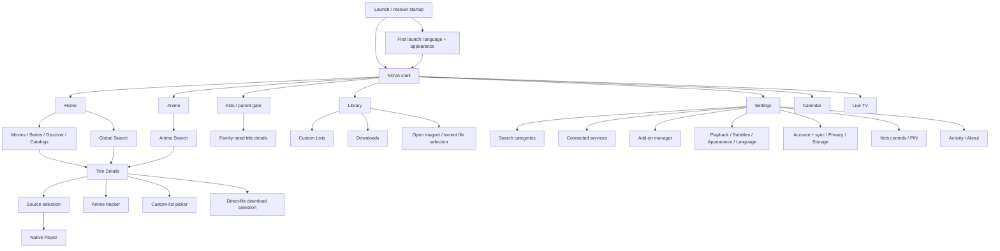

# 03 — NOVA information architecture and key flows

## Product structure

NOVA is a catalog and player with user-selected add-ons, connected tracking services and a personal library. Its primary navigation remains familiar, while its secondary destinations are grouped by intent.

## Responsive navigation

- Phones: preserve the current floating dock concept, improve active-state contrast/labels/targets, retain safe-area content clearance and make scroll hiding deliberate rather than twitchy.
- Tablets, at 840 logical pixels and above: use a persistent side navigation area with the same primary destinations plus secondary discovery/utility entries. At wider widths the labels are fully expanded.
- Settings: independent 1000 px breakpoint gives categories a 340 px master pane and a readable details pane. Below it, categories open native routes. Long controls retain intrinsic height at enlarged text sizes.
- Carousels and horizontal rails follow ambient direction. Directional chevrons mirror. Play, logos, checkmarks and universal media controls remain unchanged.
- Search is global in normal mode and withheld from the Kids shell. Leaving a Kids session requires the parent gate.

## Home discovery flow

1. Present cached real catalog artwork/data when available; show geometry-aware skeletons for a first load.
2. Keep the hero stationary while the opaque content sheet scrolls over it, with a restrained cover fade/scale that disappears under reduced motion.
3. Lead with Continue Watching when present, then recommendations/trending/discovery and installed/connected-service rails.
4. A rail title opens its full catalog where supported. A poster opens title details; Continue Watching carries the resume context.
5. An individual failed provider does not block unrelated rails. Retry is scoped to the affected content where practical.

## Title-to-play flow

1. Full-width artwork introduces the title. Metadata and the primary Play/Resume action remain legible in both modes.
2. The user can save, share, add to a list, track anime or choose download where supported.
3. Series/anime offer season selection and episodes with watched/progress state.
4. Source selection displays real provider output, quality/format and support information. The user explicitly chooses a source.
5. Existing direct URL, Debrid and native torrent resolution paths launch the player; existing error/retry/cancel behavior is preserved.
6. Cast/crew use circular images and fallback initials/icons. Production companies show provider logos where present. A conditional two-column fact table sits immediately before Similar Suggestions.

## Library and download flows

Library separates saved titles, viewing history and custom lists, with filtering/sorting applied to real data. A persistent Downloads destination is available from Library as well as tablet utilities.

Direct downloads are limited to supported HTTP(S) standalone video files. The manager queues jobs, reports progress, can cancel/retry/remove and opens completed files offline. It is explicitly a foreground process: closing/killing the app interrupts jobs and requires Retry. HLS/DASH offline packaging, DRM downloads and operating-system background download scheduling are not claimed.

Torrent storage remains a distinct existing capability. Storage settings manage those files and temporary-cache reset; direct-download disk usage must also remain discoverable through the Downloads destination.

## Add-on flow

Paste manifest URL → validate → install → success/error feedback → enabled catalog/source availability. Installed add-ons can be reordered by drag or move buttons. The provider page exposes its declared catalogs, manifest link, enabled state and external configuration page when the manifest advertises one. Removal confirms the target and effect.

## Connected-service flow

Overview → specific provider page → connect or manage. Provider-specific OAuth/device/key flows remain intact. After linking, show account/status, supported automatic-sync controls and manual sync/disconnect. There are no fabricated controls for unsupported provider capabilities.

Trakt and Simkl synchronize playback reporting. Trakt, AniList and MAL can mirror watchlist edits. AniList/MAL can update episode progress. Manual import and manual tracker edits are independent actions. TMDB supports optional personal credentials and its existing feature flag; Debrid supports Real-Debrid, AllDebrid and TorBox. MDBList is currently a built-in ratings source, not a linked personal account.

## Settings and parental flows

Settings search → logical category → immediate control update → existing persistence. App language and appearance update live. Provider-content language remains independent from app language.

Account/cloud sync uses existing device identity. Privacy provides export/restore and scoped destructive controls. Kids PIN creation/change uses local secure storage, is excluded from cloud settings and includes failed-attempt handling. A full Kids session must survive process restart and external intents must not bypass its gate; verify these paths before release.

## Auth/onboarding scope

There was no general app-auth page/backend in the inspected app. First-launch onboarding therefore introduces NOVA, chooses language/appearance and enters the app. Actual third-party account authorization stays on the dedicated integration pages. This preserves the accountless app model and avoids a fake sign-in requirement.
